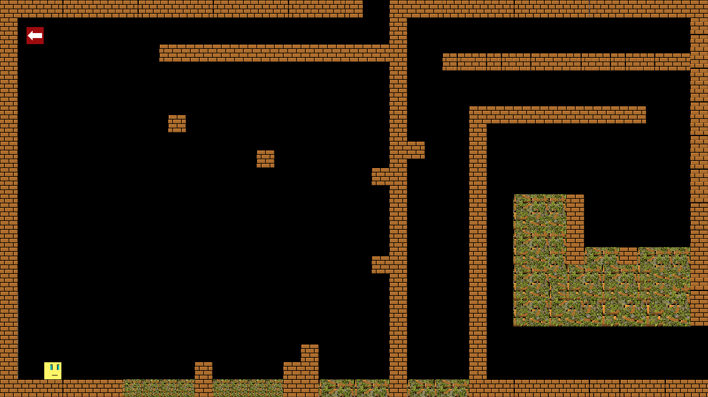
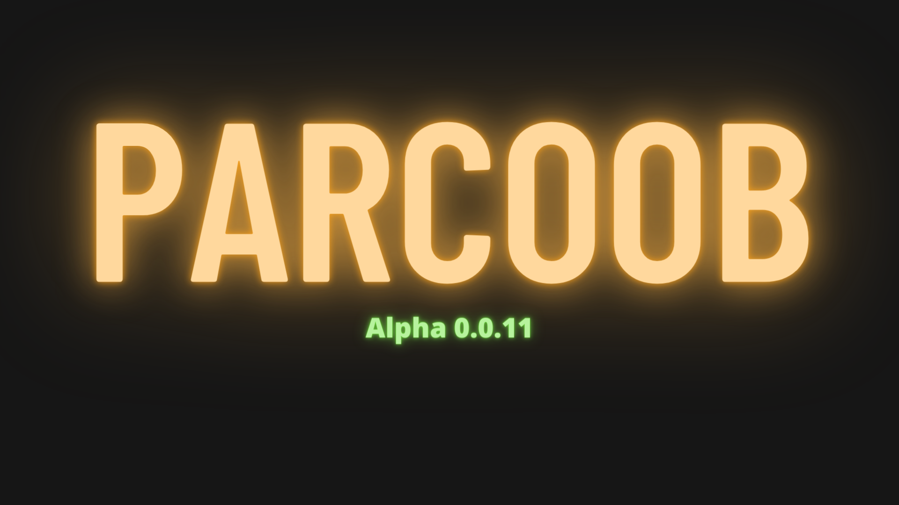
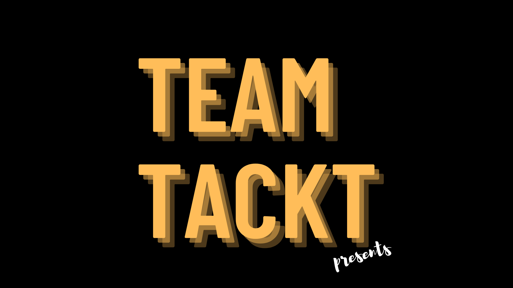

# Parcoobe

Декомпилированный исходный код платформера **Parcoob** с [GameJolt](https://gamejolt.com/games/parcoob/639890),
переименованного в **Parcoobe**.

Игра написана на **GameMaker Studio 2** (runtime 2.2.2.302), собрана 15.08.2022, внутри самой игры версия
подписана как **alpha 0.0.11**.


---

## Об игре (описание с GameJolt)

> **RUS**
>
> Это сложный платформер (но это не точно).
>
> Это тестовая версия игры она очень пустая, зато нет багов 😭
>
> Также можете подписаться на мой канал и дискорд сервер:
> Ютуб — https://www.youtube.com/channel/UCRPqifap5UGLNwUiwXriVTA
> Дискорд — https://discord.gg/d6WYPz9BY7
> Донат — https://www.donationalerts.com/r/protackt
>
> Ладно, пойду доделывать.
>
> **ENG**
>
> This is a complex platformer (but this is not accurate).
>
> This is a test version of the game, it is very empty, but there are no bugs 😭
>
> You can also subscribe to my channel and discord server:
> YouTube — https://www.youtube.com/channel/UCRPqifap5UGLNwUiwXriVTA
> Discord — https://discord.gg/d6WYPz9BY7
> DonationAlert — https://www.donationalerts.com/r/protackt
>
> Okay, I'll go finish it.
>
> `#arcade` `#platformer` `#action` `#retro` `#hardcore`

**Оригинальная страница:** https://gamejolt.com/games/parcoob/639890
**Автор:** [Protackt / «Продукт»](https://gamejolt.com/@Protackt)
**Скачивание (Google Drive, как и на GameJolt):** https://drive.google.com/drive/folders/1TGiBGUqDOtaAvE-h-xfuU0aci5cCTJG3

---

## Технические параметры сборки

| Параметр | Значение |
|---|---|
| Движок | GameMaker Studio 2 (GMS2, `data.win`, bytecode 17) |
| Runtime | 2.2.2.302 |
| YYC-компиляция | нет (обычный VM-раннер, байткод читается) |
| Разрешение окна | 1280×720 |
| Объекты | 42 |
| Комнаты | 20 |
| Спрайты | 50 (284 кадра) |
| Скрипты | 57 |
| Код (code entries) | 148 |
| Звуки | 6 (`mDamage`, `mJump` встроены, `music_1..4` — внешние ogg) |
| Шрифты | 1 (`StayPixelRegular`) |
| Строки | 1241 |
| Сборка | 15.08.2022, в игре подписана «alpha 0.0.11» |

## Что в репозитории

```
source/                 декомпилированный исходник
  objects/<объект>/     GML по событиям (Create_0.gml, Step_0.gml, Collision_with_oWall.gml, ...)
  scripts/              57 GML-скриптов
  rooms/                комнаты в JSON (размеры, слои, все инстансы с координатами)
  sprites/              все кадры спрайтов в PNG
  textures/             текстурные страницы (атласы), из которых собраны спрайты
  sounds/               музыка и встроенные звуки
  datafiles/            splash.png, шрифт
  metadata/             объекты, спрайты, звуки, шрифты, пути, переменные, функции
  strings.txt           все строки из data.win
build/                  пересобранная игра Parcoobe (Windows)
  Parcoobe.exe          раннер GameMaker (копия оригинального exe)
  data.win              тот же data.win, но с именем игры Parcoobe
original/               оригинальная сборка GameJolt без изменений
декомпилятор/           инструмент, которым всё это получено (UndertaleModTool CLI + скрипты)
```

## Запуск

Windows: `build/Parcoobe.exe` (рядом должны лежать `data.win`, музыка, `splash.png` и шрифт — они на месте).

Оригинал без изменений: `original/Parcoob.exe`.

## Скриншоты

Картинки уровней собраны из самих данных игры (`source/rooms/*.json` + `source/sprites/`), то есть это
реальное содержимое комнат, отрисованное по координатам инстансов:

| | |
|---|---|
|  |  |
| `lvl_1` — первый уровень | `lvl_6` — второй мир |
|  |  |
| Обложка со страницы GameJolt | `splash.png` из сборки |

## Как это сделано

1. Страница GameJolt отдала ссылку на папку Google Drive, оттуда скачаны `PARCOOB.rar` и `PARCOOB (1).rar` —
   это готовые сборки (exe + `data.win`), а не проекты.
2. `data.win` — контейнер GameMaker Studio 2. Байткод не зашифрован и не скомпилирован в нативный код
   (YYC выключен), поэтому он разбирается **UndertaleModTool** (ветка `UndertaleModCli`, .NET 10, Linux).
3. Командой `dump --code UMT_DUMP_ALL` выгружены все 148 code entries, декомпилятор UTMT восстановил GML.
4. Скриптами из [`декомпилятор/scripts`](декомпилятор/scripts) выгружены комнаты, метаданные объектов/спрайтов/звуков,
   а также переименованы строки `PARCOOB`/`Parcoob` → `PARCOOBE`/`Parcoobe` с сохранением нового `data.win`.

Подробности и инструкция по повторению — в [`декомпилятор/README.md`](декомпилятор/README.md).

### Чем это отличается от оригинала

* имя проекта и заголовок окна — `Parcoobe` (в `data.win` заменены две строки, больше ничего не менялось
  байт-в-байт: код, комнаты, графика, музыка — как в игре от 15.08.2022);
* exe переименован в `Parcoobe.exe`;
* логотип на титульном экране — это спрайт `sName` (он же обложка на GameJolt), он остался оригинальным, надпись «PARCOOB» в нём
  не перерисовывалась.

GML из декомпилятора — не побайтовая копия исходников автора: имена локальных переменных и структура
выражений восстановлены эвристически, часть конструкций может выглядеть иначе, но логика соответствует
байткоду. Оригинальные имена ассетов (объекты, спрайты, комнаты, скрипты) сохранены.

## Права

Игра, её код, графика, музыка и логотип принадлежат автору — **Protackt** («Продукт»).
Здесь лежит декомпилированная версия для изучения, моддинга и сохранения; коммерческого использования нет.
Если автор против публикации — напишите, репозиторий будет удалён.

Инструмент в папке `декомпилятор/` — [UndertaleModTool](https://github.com/UnderminersTeam/UndertaleModTool)
команды UnderminersTeam, лицензия GPL-3.0.
