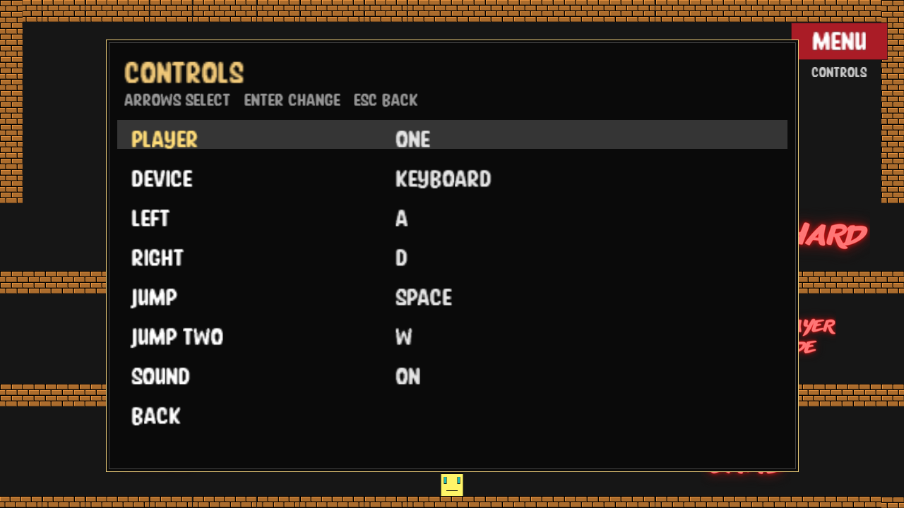
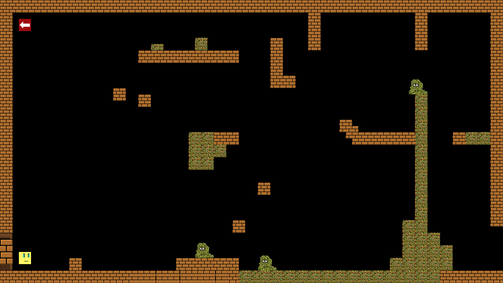
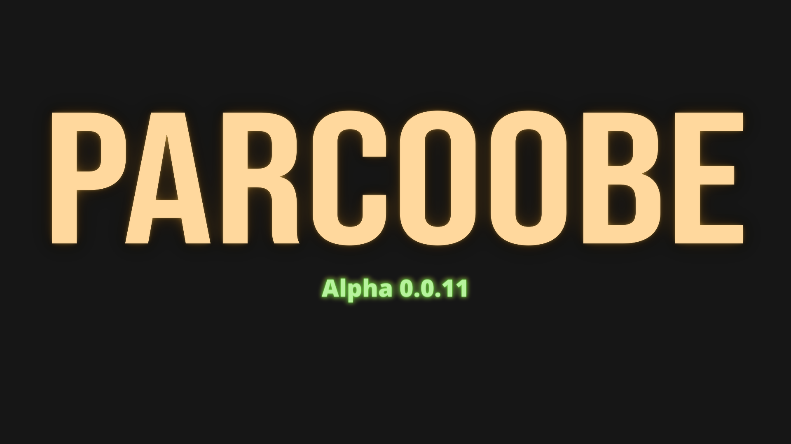

# Parcoobe

Декомпилированный исходный код платформера **Parcoob** с [GameJolt](https://gamejolt.com/games/parcoob/639890),
переименованного в **Parcoobe**.

Игра написана на **GameMaker Studio 2** (runtime 2.2.2.302). Оригинальная сборка — 15.08.2022 (alpha 0.0.11),
текущая пересобранная версия — **1.0.2**.

Оригинальный скриншот со страницы GameJolt:


Меню пересобранной игры (снято из живого `build/Parcoobe.exe`):


---

## Об игре (описание с GameJolt)

> **RUS**
>
> Это сложный платформер (но это не точно).
>
> Это тестовая версия игры она очень пустая, зато нет багов 😭
>
> Также можете подписаться на мой канал и дискорд сервер:
> Ютуб — https://www.youtube.com/channel/UCRPqifap5UGLNwUiwXriVTA
> Дискорд — https://discord.gg/d6WYPz9BY7
> Донат — https://www.donationalerts.com/r/protackt
>
> Ладно, пойду доделывать.
>
> **ENG**
>
> This is a complex platformer (but this is not accurate).
>
> This is a test version of the game, it is very empty, but there are no bugs 😭
>
> You can also subscribe to my channel and discord server:
> YouTube — https://www.youtube.com/channel/UCRPqifap5UGLNwUiwXriVTA
> Discord — https://discord.gg/d6WYPz9BY7
> DonationAlert — https://www.donationalerts.com/r/protackt
>
> Okay, I'll go finish it.
>
> `#arcade` `#platformer` `#action` `#retro` `#hardcore`

**Оригинальная страница:** https://gamejolt.com/games/parcoob/639890
**Автор:** [Protackt / «Продукт»](https://gamejolt.com/@Protackt)
**Скачивание (Google Drive, как и на GameJolt):** https://drive.google.com/drive/folders/1TGiBGUqDOtaAvE-h-xfuU0aci5cCTJG3

---

## Технические параметры сборки

| Параметр | Значение |
|---|---|
| Движок | GameMaker Studio 2 (GMS2, `data.win`, bytecode 17) |
| Runtime | 2.2.2.302 |
| YYC-компиляция | нет (обычный VM-раннер, байткод читается) |
| Разрешение окна | 1280×720 |
| Объекты | 42 |
| Комнаты | 20 |
| Спрайты | 50 (284 кадра) |
| Скрипты | 57 |
| Код (code entries) | 148 |
| Звуки | 6 (`mDamage`, `mJump` встроены, `music_1..4` — внешние ogg) |
| Шрифты | 1 (`StayPixelRegular`) |
| Строки | 1241 |
| Сборка | оригинал 15.08.2022 (alpha 0.0.11), эта — 1.0.2 |

## Что нового в 1.0.2

* **Авто-обновление**: при запуске игра запрашивает `version.txt` из этого репозитория
  (`https://raw.githubusercontent.com/hakeroneh1/Parcoobe/main/version.txt`). Если версия новее —
  внизу меню появляется плашка `NEW VERSION AVAILABLE` / `PRESS U TO DOWNLOAD`, по `U` открывается
  страница релизов в браузере.
* **Отключается в настройках**: `MENU`/`F1` → строка `AUTO UPDATE: ON/OFF` (сохраняется в ini).
* **`CHECK NOW`** — проверить обновление вручную; внизу панели показывается результат
  (`YOU HAVE THE LATEST VERSION` / `UPDATE FOUND` / `UPDATE CHECK FAILED`).
* Всё, что было в 1.0.1, на месте.

## Что нового в 1.0.1

* **Управление**: по умолчанию `A` — влево, `D` — вправо, прыжок — `Space` **и** `W`; игрок 2 — стрелки
  и `Numpad 0`/`↑`. Работает геймпад (крестовина и левый стик, `A`/правый бампер).
* **Переназначение**: кнопка **MENU** в правом верхнем углу меню или `F1` — открывается панель `CONTROLS`:
  `PLAYER` (какой игрок настраивается), `DEVICE` (KEYBOARD/GAMEPAD), `LEFT`, `RIGHT`, `JUMP`, `JUMP TWO`,
  `SOUND`, `BACK`. Стрелки — выбор строки, `Enter` — сменить/переназначить (дальше просто нажать клавишу
  или кнопку геймпада), `Esc` — выход. Настройки сохраняются в `parcoobe.ini`
  (в Windows — `%LOCALAPPDATA%\PARCOOBE\`).
* **Любые комбинации игроков**: игрок 1 на клавиатуре + игрок 2 на геймпаде, оба на геймпадах (P1 — первый
  подключённый, P2 — второй), оба на клавиатуре (**два разных набора клавиш** — Windows-GameMaker не умеет
  различать две физические клавиатуры, поэтому «две клавиатуры» реализованы как два набора клавиш на одной).
* **Оформление**: логотип `PARCOOBE` перерисован с объёмом и тенью, подпись `Version 1.0.1` вместо
  `Alpha 0.0.11`, между буквами ровные одинаковые отступы.
* **Меню**: убраны кнопки закрытия (X) и звука — вместо них одна кнопка **MENU** в стиле игры; звук
  переключается в панели `CONTROLS`.
* **Двери**: спрайты `sDoor`/`sClosedoor` перерисованы (были плоские синие блоки) — теперь это деревянные
  двери в стиле игры; двери-выходы в меню сдвинуты из-за края экрана в кадр, входы стало видно.
* **Убран сплэш** «TEAM TACKT presents» — игра стартует сразу с меню.
* **Исправленные баги**: `variable_global_set(global.hard, 0)` в хардкоре (падало при смерти) заменено на
  `global.hard = 0`; анимация игрока больше не смотрит на «сырые» клавиши, а на переназначенные;
  настройки не сбиваются при выходе.

## Что в репозитории

```
mod/                    GML-моды 1.0.1 (вставляются в data.win при сборке)
source/                 декомпилированный исходник
  objects/<объект>/     GML по событиям (Create_0.gml, Step_0.gml, Collision_with_oWall.gml, ...)
  scripts/              57 GML-скриптов
  rooms/                комнаты в JSON (размеры, слои, все инстансы с координатами)
  sprites/              все кадры спрайтов в PNG
  textures/             текстурные страницы (атласы), из которых собраны спрайты
  sounds/               музыка и встроенные звуки
  datafiles/            splash.png, шрифт
  metadata/             объекты, спрайты, звуки, шрифты, пути, переменные, функции
  strings.txt           все строки из data.win
build/                  пересобранная игра Parcoobe (Windows)
  Parcoobe.exe          раннер GameMaker (копия оригинального exe)
  data.win              тот же data.win, но с именем игры Parcoobe
original/               оригинальная сборка GameJolt без изменений
декомпилятор/           инструмент, которым всё это получено (UndertaleModTool CLI + скрипты сборки)
src_project/            исходный проект GMS2 от автора игры (прислан разработчиком)
```

## Запуск

Windows: `build/Parcoobe.exe` (рядом должны лежать `data.win`, музыка и шрифт — они на месте;
`splash.png` больше не нужен).

Оригинал без изменений: `original/Parcoob.exe`.

## Скриншоты

Панель управления (снята из игры, `F1` или кнопка MENU):



Уровни: картинки собраны из самих данных игры (`source/rooms/*.json` + `source/sprites/`) — это реальное
содержимое комнат, отрисованное по координатам инстансов:

| | |
|---|---|
|  |  |
| `lvl_1` — первый уровень | `lvl_6` — второй мир |
|  |  |
| Новый логотип (спрайт `sName`) | Оригинальная страница GameJolt |

## Как это сделано

1. Страница GameJolt отдала ссылку на папку Google Drive, оттуда скачаны `PARCOOB.rar` и `PARCOOB (1).rar` —
   это готовые сборки (exe + `data.win`), а не проекты.
2. `data.win` — контейнер GameMaker Studio 2. Байткод не зашифрован и не скомпилирован в нативный код
   (YYC выключен), поэтому он разбирается **UndertaleModTool** (ветка `UndertaleModCli`, .NET 10, Linux).
3. Командой `dump --code UMT_DUMP_ALL` выгружены все 148 code entries, декомпилятор UTMT восстановил GML.
4. Скриптами из [`декомпилятор/scripts`](декомпилятор/scripts) выгружены комнаты, метаданные объектов/спрайтов/звуков,
   переименованы строки `PARCOOB`/`Parcoob` → `PARCOOBE`/`Parcoobe`, перерисован логотип и собран новый `data.win`.
5. Для 1.0.1 GML-моды (`mod/*.gml`) компилируются в байткод и вставляются в объекты через
   `декомпилятор/scripts/build_101.py`; текстурная страница собирается `make_art_101.py`.
6. Каждая сборка проверена запуском под Wine под Xvfb (скриншоты в `screenshots/`).

Подробности и инструкция по повторению — в [`декомпилятор/README.md`](декомпилятор/README.md).

### Чем это отличается от оригинала

* имя проекта и заголовок окна — `Parcoobe` (строки `PARCOOB`/`Parcoob` в `data.win` заменены на `PARCOOBE`/`Parcoobe`);
* exe переименован в `Parcoobe.exe`;
* титульный логотип перерисован: `PARCOOB` → `PARCOOBE` (спрайт `sName`, шрифт Bebas Neue, та же золотая заливка
  и свечение, подпись «Alpha 0.0.11» оставлена оригинальной) — скрипт `декомпилятор/scripts/rebuild_logo.py`;
* всё остальное — код, комнаты, графика, музыка — как в игре от 15.08.2022.

GML из декомпилятора — не побайтовая копия исходников автора: имена локальных переменных и структура
выражений восстановлены эвристически, часть конструкций может выглядеть иначе, но логика соответствует
байткоду. Оригинальные имена ассетов (объекты, спрайты, комнаты, скрипты) сохранены.

## Права

Игра, её код, графика, музыка и логотип принадлежат автору — **Protackt** («Продукт»).
Здесь лежит декомпилированная версия для изучения, моддинга и сохранения; коммерческого использования нет.
Если автор против публикации — напишите, репозиторий будет удалён.

Инструмент в папке `декомпилятор/` — [UndertaleModTool](https://github.com/UnderminersTeam/UndertaleModTool)
команды UnderminersTeam, лицензия GPL-3.0.
