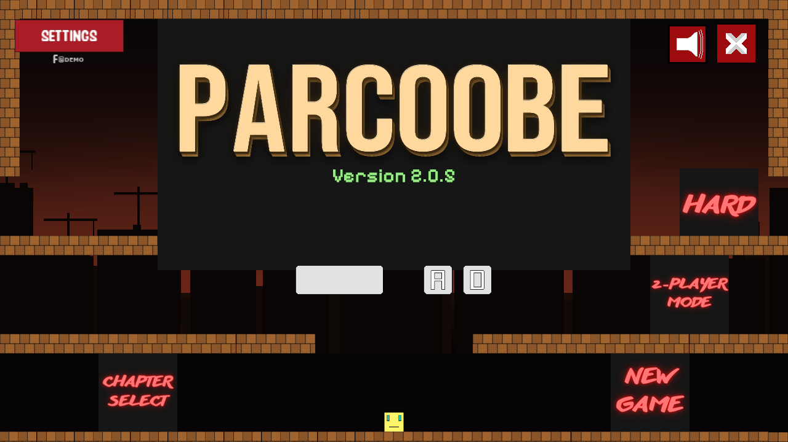
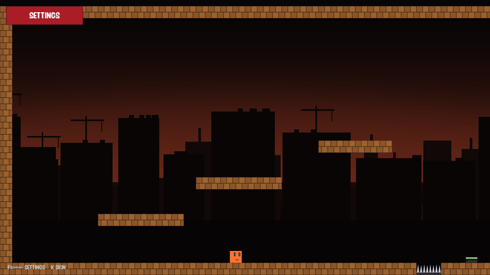
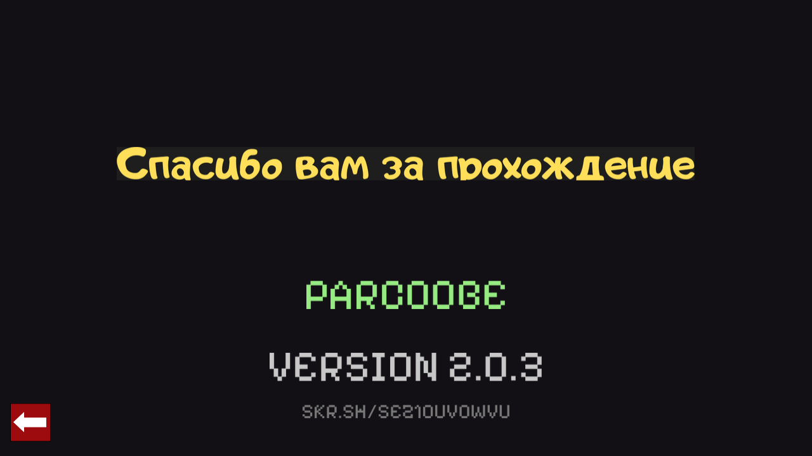

# Parcoobe

Декомпилированный исходный код платформера **Parcoob** с [GameJolt](https://gamejolt.com/games/parcoob/639890),
переименованного в **Parcoobe**.

Игра написана на **GameMaker Studio 2** (runtime 2.2.2.302). Оригинальная сборка — 15.08.2022 (alpha 0.0.11),
текущая пересобранная версия — **2.0.5**.

Оригинальный скриншот со страницы GameJolt:


Меню пересобранной игры (снято из живого `build/Parcoobe.exe`):



---

## Об игре (описание с GameJolt)

> **RUS**
>
> Это сложный платформер (но это не точно).
>
> Это тестовая версия игры она очень пустая, зато нет багов 😭
>
> Также можете подписаться на мой канал и дискорд сервер:
> Ютуб — https://www.youtube.com/channel/UCRPqifap5UGLNwUiwXriVTA
> Дискорд — https://discord.gg/d6WYPz9BY7
> Донат — https://www.donationalerts.com/r/protackt
>
> Ладно, пойду доделывать.
>
> **ENG**
>
> This is a complex platformer (but this is not accurate).
>
> This is a test version of the game, it is very empty, but there are no bugs 😭
>
> You can also subscribe to my channel and discord server:
> YouTube — https://www.youtube.com/channel/UCRPqifap5UGLNwUiwXriVTA
> Discord — https://discord.gg/d6WYPz9BY7
> DonationAlert — https://www.donationalerts.com/r/protackt
>
> Okay, I'll go finish it.
>
> `#arcade` `#platformer` `#action` `#retro` `#hardcore`

**Оригинальная страница:** https://gamejolt.com/games/parcoob/639890
**Автор:** [Protackt / «Продукт»](https://gamejolt.com/@Protackt)
**Скачивание (Google Drive, как и на GameJolt):** https://drive.google.com/drive/folders/1TGiBGUqDOtaAvE-h-xfuU0aci5cCTJG3

---

## Технические параметры сборки

| Параметр | Значение |
|---|---|
| Движок | GameMaker Studio 2 (GMS2, `data.win`, bytecode 17) |
| Runtime | 2.2.2.302 |
| YYC-компиляция | нет (обычный VM-раннер, байткод читается) |
| Разрешение окна | 1280×720 |
| Объекты | 42 |
| Комнаты | 20 |
| Спрайты | 50 (284 кадра) |
| Скрипты | 57 |
| Код (code entries) | 148 |
| Звуки | 6 (`mDamage`, `mJump` встроены, `music_1..4` — внешние ogg) |
| Шрифты | 1 (`StayPixelRegular`) |
| Строки | 1241 |
| Сборка | оригинал 15.08.2022 (alpha 0.0.11), эта — 2.0.5 |

## Что нового в 2.0.5

* **Фон как в оригинале, но свой**: тёмная коричневая дымка и чёрный силуэт города с трубами, баками и кранами
  (`art_tiles.city_background`). Слой статичный — при движении камеры фон больше не «плывёт».
* **Убраны оверлеи оригинала**: в комнатах чистится слой ассетов, поэтому поверх уровней больше не висят
  таблички `CHAPTER I` и старый декор.
* **Кирпичи перерисованы**: кладка 32×30 с раствором 2 px, все размеры делят 64 нацело — «разрывов»
  на стыках тайлов нет.
* **Батуты новые**: металлическая рама, толстая пружина и светящаяся площадка.
* **Скины**: 5 цветов куба, переключение по `K`, выбор сохраняется в `parcoobe.ini`.
* **Настройки удобнее**: кнопка `SETTINGS` в левом верхнем углу прямо в игре (мышью) плюс `F1`;
  в панели работает навигация с геймпада (крестовина/стик, `A` — выбрать, `B` — назад).
* **Уровни сложнее**: больше шипов, ям и грибов на всех этапах, добавлены полосы шипов перед дверями.
* Фон нарисован и на главном экране.

## Что нового в 2.0.4

* **Перерисованы все 15 комнат**: `chapter_1`, `lvl_1..lvl_8`, `chapter_2`, `p_2_lvl_1..p_2_lvl_5` —
  длинные уровни (1920–3200 px) с камерой, ямами, шипами и батутами; сложность растёт от `lvl_1` к `lvl_8`.
* **Маршрут целиком**: `Menu → chapter_1 → lvl_1 → … → lvl_5 → chapter_2 → lvl_6 → … → lvl_8 → fin`,
  переходы с затемнением (`transition_kind`).
* **Грибы ходят**: у `oMushroomBleb` свой патруль (разворот у стены, у шипов и на краю платформы),
  стоят на полу и расставлены по уровням.
* **Музыка на каждой сцене**: свой трек на акт, тишины больше нет. `music_2..music_4` заменены на новые
  чиптюн-треки, сгенерированные скриптом (`tools/make_music.py`).
* **Своя графика**: кирпичи, шипы, батут и ночное небо с луной, звёздами и городом нарисованы процедурно
  (`декомпилятор/scripts/art_tiles.py`) — оригинальные текстуры стен и опасностей больше не используются.
* **Настройки работают в игре**: `F1` открывает панель `CONTROLS` прямо в уровне, переназначение клавиш
  сохраняется в `parcoobe.ini`.
* **В меню вместо стрелок — клавиши `A` и `D`** (по умолчанию ходят на них).
* Фон с параллаксом (небо + кладка) есть на всех уровнях, включая кооперативные.

## Что нового в 2.0.3

* **Уровни стали длиннее экрана**: комнаты 2560 px (`lvl_1..lvl_4`) и 3200 px (`lvl_5`), за игроком едет
  камера (`view_camera` + `camera_set_view_pos`, вид включён в самих комнатах).
* **Сложнее**: ямы до 4 клеток, полосы шипов на полу, узкие полки, батуты перед опасными участками;
  смерть по-прежнему перезапускает уровень с начала.
* **Фон в два слоя с параллаксом**: город (`dead_city`) тайлится по горизонтали и едет медленнее комнаты,
  позади него — кладка (`bricks_background`) ещё медленнее. Фон есть на всех пяти уровнях.
* **Финальный экран переделан**: убрана простыня текста, остались заголовок «Спасибо вам за прохождение»,
  подпись `PARCOOBE`, версия, ссылка `skr.sh/seZ10UVowvU` и кнопка возврата в меню.
* Всё из 2.0.2 (двери, `F11`, кнопка `SETTINGS`, бесшовные текстуры, один exe) на месте.

## Что нового в 2.0.2

* **Двери работают**: вход в дверь переводит на следующий уровень явной цепочкой
  `Menu → lvl_1 → lvl_2 → lvl_3 → lvl_4 → lvl_5 → финал` (раньше `room_goto_next()` уводил
  в старые комнаты `chapter_2`/`lvl_6..8`, которых в игре больше нет).
* **Пять уровней нарисованы с нуля** (`декомпилятор/scripts/gen_levels.py` → `уровни/lvl_1..5.json`):
  ровная сетка 32 px, платформы, ямы, шипы, батуты; игрок стартует на полу и нигде не застревает.
* **`F11` — полный экран** (работает в любом режиме, туда-обратно).
* **Кнопка `SETTINGS`** в левом верхнем углу меню — видна и кликабельна; панель также по `F1`.
  Игру можно начать по `Enter` или кликом по `NEW GAME` / `CHAPTER SELECT`.
* **Текстуры без швов**: `sWall` перерисован бесшовным (у оригинала по краям чёрная рамка),
  тайлы выровнены по целым пикселям.
* **Один exe**: `Parcoobe-Single.exe` — самодостаточный файл, внутри которого лежит раннер,
  `data.win`, музыка и шрифт; при запуске распаковывается в `%LOCALAPPDATA%\Parcoobe\game`
  и запускает игру (собирается `tools/build_single_exe.py`, лаунчер — `tools/parcoobe_launcher.c`).

## Что нового в 2.0.1

* **3D-версия убрана** — остаётся классическая 2D-игра на GameMaker.
* **Меню как в оригинале**: вернулись кнопки звука и закрытия на своих местах, двери-выходы снова за
  краем экрана (как было в оригинале). Панель настроек управления остаётся на `F1`.
* Логотип `PARCOOBE` и подпись `Version 2.0.1`.
* Позиции тайлов стен/дверей выровнены по целым пикселям — убирает швы между текстурами.
* Страховка от проваливания: если игрок ушёл ниже комнаты, уровень перезапускается.

## Что нового в 1.0.2

* **Авто-обновление**: при запуске игра запрашивает `version.txt` из этого репозитория
  (`https://raw.githubusercontent.com/hakeroneh1/Parcoobe/main/version.txt`). Если версия новее —
  внизу меню появляется плашка `NEW VERSION AVAILABLE` / `PRESS U TO DOWNLOAD`, по `U` открывается
  страница релизов в браузере.
* **Отключается в настройках**: `MENU`/`F1` → строка `AUTO UPDATE: ON/OFF` (сохраняется в ini).
* **`CHECK NOW`** — проверить обновление вручную; внизу панели показывается результат
  (`YOU HAVE THE LATEST VERSION` / `UPDATE FOUND` / `UPDATE CHECK FAILED`).
* Всё, что было в 1.0.1, на месте.

## Что нового в 1.0.1

* **Управление**: по умолчанию `A` — влево, `D` — вправо, прыжок — `Space` **и** `W`; игрок 2 — стрелки
  и `Numpad 0`/`↑`. Работает геймпад (крестовина и левый стик, `A`/правый бампер).
* **Переназначение**: кнопка **MENU** в правом верхнем углу меню или `F1` — открывается панель `CONTROLS`:
  `PLAYER` (какой игрок настраивается), `DEVICE` (KEYBOARD/GAMEPAD), `LEFT`, `RIGHT`, `JUMP`, `JUMP TWO`,
  `SOUND`, `BACK`. Стрелки — выбор строки, `Enter` — сменить/переназначить (дальше просто нажать клавишу
  или кнопку геймпада), `Esc` — выход. Настройки сохраняются в `parcoobe.ini`
  (в Windows — `%LOCALAPPDATA%\PARCOOBE\`).
* **Любые комбинации игроков**: игрок 1 на клавиатуре + игрок 2 на геймпаде, оба на геймпадах (P1 — первый
  подключённый, P2 — второй), оба на клавиатуре (**два разных набора клавиш** — Windows-GameMaker не умеет
  различать две физические клавиатуры, поэтому «две клавиатуры» реализованы как два набора клавиш на одной).
* **Оформление**: логотип `PARCOOBE` перерисован с объёмом и тенью, подпись `Version 1.0.1` вместо
  `Alpha 0.0.11`, между буквами ровные одинаковые отступы.
* **Меню**: убраны кнопки закрытия (X) и звука — вместо них одна кнопка **MENU** в стиле игры; звук
  переключается в панели `CONTROLS`.
* **Двери**: спрайты `sDoor`/`sClosedoor` перерисованы (были плоские синие блоки) — теперь это деревянные
  двери в стиле игры; двери-выходы в меню сдвинуты из-за края экрана в кадр, входы стало видно.
* **Убран сплэш** «TEAM TACKT presents» — игра стартует сразу с меню.
* **Исправленные баги**: `variable_global_set(global.hard, 0)` в хардкоре (падало при смерти) заменено на
  `global.hard = 0`; анимация игрока больше не смотрит на «сырые» клавиши, а на переназначенные;
  настройки не сбиваются при выходе.

## Что в репозитории

```
mod/                    GML-моды 1.0.1 (вставляются в data.win при сборке)
source/                 декомпилированный исходник
  objects/<объект>/     GML по событиям (Create_0.gml, Step_0.gml, Collision_with_oWall.gml, ...)
  scripts/              57 GML-скриптов
  rooms/                комнаты в JSON (размеры, слои, все инстансы с координатами)
  sprites/              все кадры спрайтов в PNG
  textures/             текстурные страницы (атласы), из которых собраны спрайты
  sounds/               музыка и встроенные звуки
  datafiles/            splash.png, шрифт
  metadata/             объекты, спрайты, звуки, шрифты, пути, переменные, функции
  strings.txt           все строки из data.win
уровни/                 новые уровни lvl_1..lvl_5 в JSON (генерируются gen_levels.py)
tools/                  сборка одного exe (лаунчер на C + упаковщик)
build/                  пересобранная игра Parcoobe (Windows)
  Parcoobe.exe          раннер GameMaker (копия оригинального exe)
  data.win              тот же data.win, но с именем игры Parcoobe
original/               оригинальная сборка GameJolt без изменений
декомпилятор/           инструмент, которым всё это получено (UndertaleModTool CLI + скрипты сборки)
src_project/            исходный проект GMS2 от автора игры (прислан разработчиком)
```

## Запуск

Одним файлом: **`Parcoobe-Single.exe`** (из релиза) — ничего рядом не нужно, всё внутри.

Папкой: `build/Parcoobe.exe` (рядом должны лежать `data.win`, музыка и шрифт — они на месте;
`splash.png` больше не нужен).

Оригинал без изменений: `original/Parcoob.exe`.

## Скриншоты

Панель управления (снята из игры, `F1` или кнопка MENU):


Уровни: картинки собраны из самих данных игры (`source/rooms/*.json` + `source/sprites/`) — это реальное
содержимое комнат, отрисованное по координатам инстансов:

| | |
|---|---|
|  |  |
| `lvl_1` в 2.0.3 — длинный уровень с камерой | Финальный экран |
|  |  |
| Новый логотип (спрайт `sName`) | Оригинальная страница GameJolt |

## Как это сделано

1. Страница GameJolt отдала ссылку на папку Google Drive, оттуда скачаны `PARCOOB.rar` и `PARCOOB (1).rar` —
   это готовые сборки (exe + `data.win`), а не проекты.
2. `data.win` — контейнер GameMaker Studio 2. Байткод не зашифрован и не скомпилирован в нативный код
   (YYC выключен), поэтому он разбирается **UndertaleModTool** (ветка `UndertaleModCli`, .NET 10, Linux).
3. Командой `dump --code UMT_DUMP_ALL` выгружены все 148 code entries, декомпилятор UTMT восстановил GML.
4. Скриптами из [`декомпилятор/scripts`](декомпилятор/scripts) выгружены комнаты, метаданные объектов/спрайтов/звуков,
   переименованы строки `PARCOOB`/`Parcoob` → `PARCOOBE`/`Parcoobe`, перерисован логотип и собран новый `data.win`.
5. Для 1.0.1 GML-моды (`mod/*.gml`) компилируются в байткод и вставляются в объекты через
   `декомпилятор/scripts/build_101.py`; текстурная страница собирается `make_art_101.py`.
6. Каждая сборка проверена запуском под Wine под Xvfb (скриншоты в `screenshots/`).

Подробности и инструкция по повторению — в [`декомпилятор/README.md`](декомпилятор/README.md).

### Чем это отличается от оригинала

* имя проекта и заголовок окна — `Parcoobe` (строки `PARCOOB`/`Parcoob` в `data.win` заменены на `PARCOOBE`/`Parcoobe`);
* exe переименован в `Parcoobe.exe`;
* титульный логотип перерисован: `PARCOOB` → `PARCOOBE` (спрайт `sName`, шрифт Bebas Neue, та же золотая заливка
  и свечение, подпись «Alpha 0.0.11» оставлена оригинальной) — скрипт `декомпилятор/scripts/rebuild_logo.py`;
* всё остальное — код, комнаты, графика, музыка — как в игре от 15.08.2022.

GML из декомпилятора — не побайтовая копия исходников автора: имена локальных переменных и структура
выражений восстановлены эвристически, часть конструкций может выглядеть иначе, но логика соответствует
байткоду. Оригинальные имена ассетов (объекты, спрайты, комнаты, скрипты) сохранены.

## Права

Игра, её код, графика, музыка и логотип принадлежат автору — **Protackt** («Продукт»).
Здесь лежит декомпилированная версия для изучения, моддинга и сохранения; коммерческого использования нет.
Если автор против публикации — напишите, репозиторий будет удалён.

Инструмент в папке `декомпилятор/` — [UndertaleModTool](https://github.com/UnderminersTeam/UndertaleModTool)
команды UnderminersTeam, лицензия GPL-3.0.
